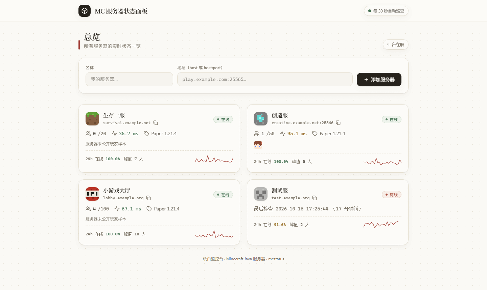
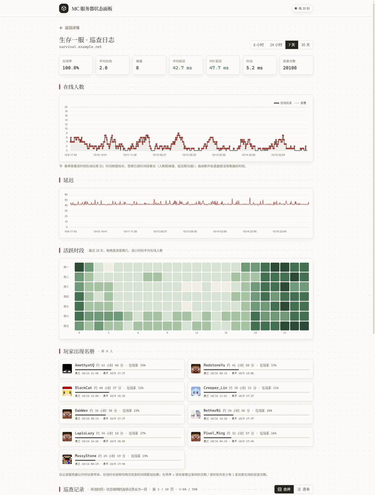
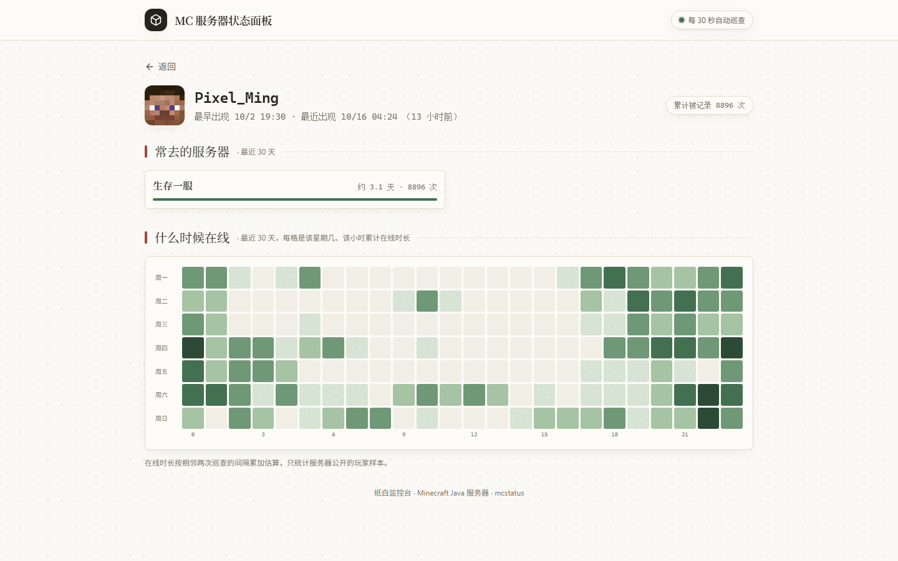
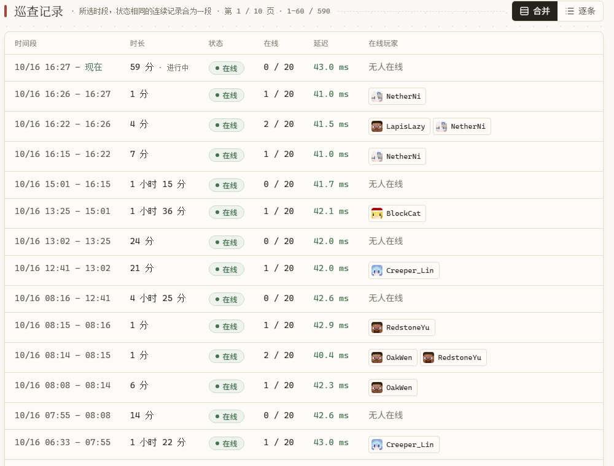
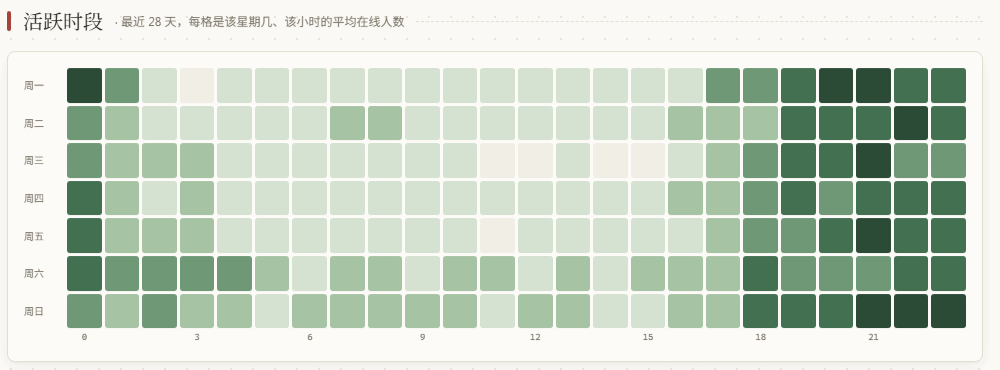

# MC 服务器状态面板

看 Minecraft 服务器在不在线、谁在玩、延迟多少。每 30 秒自动查一次。



| 历史页 | 玩家页 |
|---|---|
|  |  |

| 合并记录 | 活跃时段 |
|---|---|
|  |  |

## 使用

```bash
git clone https://github.com/Huoyuuu/mc-dashboard.git
cd mc-dashboard
docker compose up -d
```

打开 `http://服务器IP:18000`，填上服务器地址就行。

更新：

```bash
git pull && docker compose pull && docker compose up -d
```

数据在 `data/` 目录，旧版本的数据升级时会自动迁移。

不用 Docker 的话：装好 [uv](https://docs.astral.sh/uv/) 后运行 `uv run python app.py`。

## 可选设置

| 环境变量 | 默认 | 作用 |
|---|---|---|
| `MC_DASH_PORT` | `18000` | 端口 |
| `MC_DASH_TZ` | `Asia/Shanghai` | 显示时区 |
| `MC_DASH_DATA_DIR` | `./data` | 数据目录 |

## 许可证

MIT
