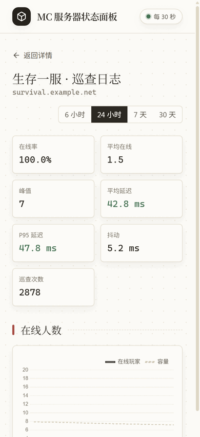
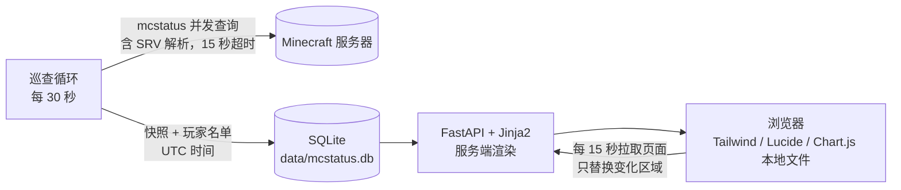

# MC 服务器状态面板

给朋友圈子用的 Minecraft Java 服务器状态面板。每 30 秒查一次所有服务器，记下在线人数、延迟、版本、MOTD 和公开的玩家名单，用纸白色的页面展示出来。


## 能看到什么

- **总览**：每台服务器的图标、在线状态、人数、延迟（绿 / 黄 / 红三档），24 小时在线率、峰值和延迟走势小图。地址旁边一点就能复制。
- **详情页**：当前状态、MOTD、在线玩家。"立即刷新"在后台查询，页面不跳转。
- **历史页**：6 小时到 30 天的人数和延迟曲线（悬停显示当时谁在线），在线率、平均 / P95 延迟、抖动，玩家出现名册和估算在线时长。
- **活跃时段热力图**：星期 × 小时，一眼看出大家一般什么时候上线。
- **巡查记录合并视图**：状态和玩家名单都没变的连续记录合成一段，例如"20:31 – 22:05，1 小时 34 分，A B C 在线"。也可以切回逐条查看。
- **玩家页**：点任意玩家名进入，看他最早、最近一次出现，常去哪台服，一般什么时候在线。
- 页面每 15 秒局部刷新，不会整页闪。所有静态资源都由面板自己提供，不依赖外部 CDN，国内打开也快。

| 历史页 | 玩家页 |
|---|---|
|  |  |

| 活跃时段 | 合并视图 |
|---|---|
|  |  |

<p>
  
  
</p>

截图用的是 `scripts/seed_demo.py` 生成的演示数据，服务器地址和玩家名都是虚构的。

## 快速开始

### Docker（推荐）

```bash
git clone https://github.com/Huoyuuu/mc-dashboard.git
cd mc-dashboard
docker compose up -d --build
```

打开 `http://<服务器 IP>:18006`，在页面上添加服务器地址（`host` 或 `host:port`）即可。数据保存在当前目录的 `data/` 里。

更新：

```bash
git pull && docker compose up -d --build
# 或者直接用发布好的镜像
docker compose pull && docker compose up -d
```

### 不用 Docker

需要 [uv](https://docs.astral.sh/uv/)：

```bash
uv sync
uv run python app.py
```

想常驻后台的话，systemd 配置示例如下：

```ini
[Unit]
Description=MC dashboard
After=network-online.target

[Service]
WorkingDirectory=/opt/mc-dashboard
ExecStart=/usr/local/bin/uv run python app.py
Restart=always

[Install]
WantedBy=multi-user.target
```

## 从旧版本升级

直接 `git pull` 然后重启。第一次启动时会自动完成以下几件事，日志里能看到对应提示：

1. 很早的版本把数据库放在仓库根目录 `mcstatus.db`，会被自动移到 `data/mcstatus.db`。
2. 旧版本存的是不带时区的本地时间。新版本统一存 UTC，启动时会按 `MC_DASH_TZ`（默认 UTC+8）换算一次。换算前会把整库备份成 `data/mcstatus.db.bak-<时间>`，确认没问题后可以删掉。
3. 补上新加的列和索引。数据量大时，第一次启动会多花几秒。

其他注意事项：

- 旧版本的默认端口是 18000，新版本是 18006。不想改反向代理配置的话，设置 `MC_DASH_PORT=18000`。
- 从直接运行换到 Docker：容器只挂载 `data/`，所以先执行 `mkdir -p data && mv mcstatus.db* data/`，把旧库放进去再启动。

## 配置

都是环境变量，全部可选：

| 变量 | 默认值 | 说明 |
|---|---|---|
| `MC_DASH_PORT` | `18006` | 监听端口 |
| `MC_DASH_HOST` | `0.0.0.0` | 监听地址 |
| `MC_DASH_DATA_DIR` | `./data` | 数据库所在目录 |
| `MC_DASH_TZ` | `Asia/Shanghai` | 页面显示时区，也是旧数据（无时区）的解读时区 |
| `MC_DASH_NO_POLL` | 空 | 设为任意值则不启动定时查询，截图和调试时用 |

快照保留 90 天，过期的自动清理。备份时只需要复制 `data/mcstatus.db`。

## 工作原理



- 所有服务器并发查询，单台超时不影响其他服务器。查不到时记一条离线快照。
- 历史图表超过 600 个点时会按时间段聚合，人数取峰值、延迟取均值。面板自己停机的时段，曲线会断开。
- 在线时长用相邻两次巡查的间隔累加来估算，单次间隔最多算 90 秒，这样轮询间隔改过之后也不会算错。
- 历史页的计算结果按"服务器 + 时段 + 最新快照"缓存，翻页和切换视图不会重算。

## JSON API

```bash
curl http://127.0.0.1:18006/api/servers                      # 所有服务器和最新快照
curl "http://127.0.0.1:18006/api/server/1/history?limit=200"  # 某台服务器最近 N 条快照
curl http://127.0.0.1:18006/healthz                          # 巡查是否正常，卡住时返回 503
```

## 开发

```bash
uv run pytest                          # 测试
uv run python scripts/seed_demo.py     # 生成演示库（默认 14 天，--days 90 可压测）
MC_DASH_DATA_DIR=<演示库目录> MC_DASH_NO_POLL=1 uv run python app.py
sh scripts/build_css.sh                # 改了模板里的 class 之后重新生成 static/app.css
```

`build_css.sh` 需要 [Tailwind CSS v4 standalone](https://github.com/tailwindlabs/tailwindcss/releases) 可执行文件，命名为 `tailwindcss` 并放进 PATH。编译出的 `static/app.css` 已提交到仓库，运行面板和构建 Docker 镜像都不需要它。

## 许可证

[MIT](LICENSE)
